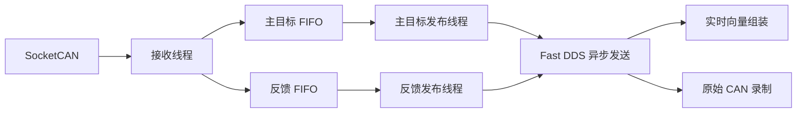

# CAN 接收与 ROS 发布解耦及 QoS 调整（2026-11-11）

## 实现

`piper_direct_can_node.py` 每条 CAN 总线使用一个接收线程，仅进行 SocketCAN 接收、来源分类和非阻塞入队。主目标与从臂反馈各使用独立 FIFO 和发布线程，在发布线程中进行 SDK 解码、ROS 消息构造与发布。两个方向的发布互不共用同一个消费线程。

接收路径不调用 ROS 发布或 ROS 日志。接收缓冲配置结果与接收异常由主线程的诊断定时器报告。每个发布线程拥有自己的 SDK parser，保留同一来源流内的 FIFO 顺序。

原始 SocketCAN `timestamp`、CAN ID 和 8 字节载荷不改写，继续按既有规则构造 Header 和 ROS 解码字段。没有更新时间戳、扩宽 stale 阈值或把过时目标解释为保持。

## 有界缓存和错误处理

| 参数 | 默认值 | 用途 |
| --- | ---: | --- |
| `receive_buffer_bytes` | 16777216 | SocketCAN 接收缓冲请求，沿用现有配置 |
| `receive_queue_depth` | 4096 | 每个方向的应用 FIFO 容量 |
| `publisher_qos_depth` | 1000 | 原始 CAN 归档发布者历史深度 |
| `input_qos_depth` | 32 | 向量节点实时输入历史深度 |

队列满时不阻塞接收线程等待 ROS，也不覆盖旧消息或静默丢帧：记录 `overflow` 与丢失源 Header，标记 `capture_failed`。发布异常记录 `publish_errors`。诊断主线程报告失败后停止接收，保留约两个诊断周期用于发送失败状态，再退出节点。长时间下游阻塞因此表现为明确失败，而不是一条看似完整的成功采集。

正常关闭先停止并等待接收线程，再排空发布队列。ROS context 已关闭时无法发布的消息计入 `shutdown_discarded`；未退出的工作线程不会与发布者销毁并发。节点结束时仍保留最终诊断到日志。

队列容量只用于吸收短时调度抖动；它不是延长数据时效的许可。排队过久的消息保持旧 Header，下游仍会判 stale 或切断连续片段。

## QoS 和 GIL

Humble 的 `rclpy` 发布实现没有在 `rcl_publish` 周围释放 GIL，因此 Python 线程拆分本身不构成对任意原生阻塞的硬隔离。[rclpy 实现](https://github.com/ros2/rclpy/blob/humble/rclpy/src/rclpy/publisher.cpp)

只读 CAN 进程在初始化 DDS 前加载打包的 `direct_can_fastdds.xml`：

- 网络发送使用 `ASYNCHRONOUS`，从 Python 调用线程移交给 DDS 发送线程。
- 原始 CAN 发布者继续使用 `RELIABLE + KEEP_LAST(1000)`；`max_blocking_time=0`，历史资源不足时返回错误，由节点记录并停止采集。
- 内存策略为 `PREALLOCATED_WITH_REALLOC`，关闭 data sharing，并保留现场现有 UDP-only 传输方式。
- `ros2 run` 的入口和只读采集 launch 都会设置配置；launch 在创建子进程前设置环境。仅影响只读 CAN 进程，不替换相机或录制服务的 DDS 配置。当前该非阻塞发布配置仅支持 Fast DDS。

`max_blocking_time=0` 表示不等待写资源，不表示序列化、调度或整个调用执行耗时为零。异步模式及可靠性设置行为分别由 [rmw_fastrtps 配置](https://github.com/ros2/rmw_fastrtps/blob/humble/README.md) 和 [Fast DDS Reliability QoS](https://fast-dds.docs.eprosima.com/en/2.6.x/fastdds/dds_layer/core/policy/standardQosPolicies.html#reliabilityqospolicy) 定义。当前 RMW 将 ROS 可靠性映射到 kind，保留 XML 的最大阻塞时间。[RMW 映射实现](https://github.com/ros2/rmw_fastrtps/blob/humble/rmw_fastrtps_shared_cpp/src/qos.cpp)

实时向量组装输入改为 `BEST_EFFORT + KEEP_LAST(32)`，避免实时消费者积压大量旧 CAN 帧；原始 CAN 发布仍为 RELIABLE，rosbag 原始 CAN/向量输入保持 `RELIABLE + depth=5000`。实时订阅允许丢弃积压旧帧，原始归档流继续单独接受来源完整性检查。RELIABLE 和发布计数均不等于数据已经落盘。

## 诊断与 SFT 门禁

新增每侧 `/piper_direct/{left,right}/diagnostics`，类型 `std_msgs/msg/String`，默认 5 Hz，JSON schema 为 `piper_direct_can_diagnostics/1`。

诊断包含 `received`、`enqueued`、`published`、`filtered`、`overflow`、`publish_errors`、`shutdown_discarded`、队列大小与容量、最大排队时间、最大发布调用耗时、最后接收/发布/溢出 Header，以及实际接收缓冲与 DDS 配置路径。`published` 表示 ROS 发布调用成功返回，不能替代接收确认或 bag 来源匹配。

训练采集配置与现场 `/tmp/piper_episode_config.json` 均加入两侧诊断话题。它们不使用高频 CAN 的 5000 深度覆盖，沿用普通可靠订阅。

转换器和完成帧检查在诊断话题存在时，检查所选执行臂的格式、实体归属及录制区间内状态。任何采集失败、队列溢出、发布错误或退出丢帧计数都拒绝该来源，`--extract-valid-segments` 不能将其过滤成合格数据。未包含此诊断的历史 Episode 继续按原规则检查，原始数据不回写。

## 验证

- 驱动、队列隔离、QoS、向量和实例锁：17 项测试通过。故意阻塞主目标发布时，接收线程仍收齐 401 条输入，反馈线程发布完 200 条；主目标解除阻塞后按 FIFO 发布 201 条，时间戳和载荷逐条相同。
- 容量为 2 的故障注入验证队列保持有界、溢出计数准确、采集状态失败；发布异常能够传播为采集失败，并有诊断发送宽限期。
- 采集、完成帧、真实 LeRobot 写入回读与训练门禁：106 项测试通过，其中新增诊断损失不能被过滤成合格 SFT 的测试。
- 使用本机 Fast DDS C++ API 实际加载 XML，读取到异步模式、RELIABLE、`max_blocking_time_ns=0`。
- 独立 ROS domain 的真实 DDS 配置功能测试中，4800 条合成消息全部收到，无应用队列溢出或发布错误。此测试发布与接收同进程运行，出现约 1.54 秒排队峰值，仅用于配置与完整性验证，不作为实机时效验收。

随后分别运行 30 秒静止和 30 秒主动示教全负载窗口：三路相机、两侧 CAN、向量、桌面预览和 rosbag 全开。下面均使用最终运行版本的结果，统计排除录制开始的前 3 秒发现期；独立 SocketCAN 监听用于区分主目标停发和接收链路延迟。

### 静止全负载

| 项目 | 左侧 | 右侧 |
| --- | ---: | ---: |
| 稳态反馈 stale | 0/1350 | 0/1351 |
| 最老 CAN 来源年龄 p95 | 9.79 ms | 8.37 ms |
| 原始 CAN Header→bag 接收 p95 | 2.67 ms | 2.78 ms |
| 反馈有效来源引用匹配 | 5400/5400 | 5404/5404 |
| 诊断中的溢出、发布错误、退出丢帧 | 均为 0 | 均为 0 |
| 诊断最大排队时间（含启动以来） | 4.44 ms | 8.01 ms |

左/右分别记录到 147/148 条健康诊断。最后一次快照左侧队列为空，右侧反馈队列有 1 条正常在途消息。

### 主动示教全负载

检测到真实主目标输入后自动开始录制。独立监听中，四种来源 CAN ID 的年龄连续 6 个 50 Hz 采样点均不超过 50 ms，定义为“持续输入约 100 ms 后”的区间。该条件用于识别持续输入，未修改向量原有的 100 ms stale 阈值。

| 项目 | 左侧 | 右侧 |
| --- | ---: | ---: |
| 实时监听稳态反馈 stale | 0/1350 | 0/1350 |
| 持续输入约 100 ms 后的主目标 stale | 0/890 | 0/197 |
| 上述主目标最老 CAN 来源年龄 p95 | 18.30 ms | 27.02 ms |
| 主目标原始 CAN Header→bag 接收 p95 | 5.75 ms | 11.38 ms |
| 反馈原始 CAN Header→bag 接收 p95 | 5.61 ms | 7.40 ms |
| 稳态有效主目标来源引用匹配 | 4060/4060 | 1444/1444 |
| 稳态有效反馈来源引用匹配 | 5404/5404 | 5400/5400 |
| 诊断中的溢出、发布错误、退出丢帧 | 均为 0 | 均为 0 |
| 诊断最大排队时间（含启动以来） | 9.67 ms | 11.72 ms |

左右分别记录到 142/148 条健康诊断，最后队列均为空。诊断计数和耗时上界从节点启动累计，包含等待操作期间约 2 小时的运行，不等于连续录制 2 小时。两轮全负载中三路相机均约 15 fps，无稳态 100 ms 以上缺口或 Header 倒退。主动验证前后两侧 CAN 接口的接收错误、丢包、总线错误计数没有增加。

主目标并非全程持续更新：稳态 bag 中左/右主目标仍有 335/1351、984/1350 条 stale。独立监听刚恢复新鲜输入时，左右各有 6 次单帧 stale，均处于输入恢复的第一个采样点，下一向量即恢复有效。以上结果支持本次持续输入区间内未观察到大量链路 stale，不能表述为主目标全程零 stale，也不能替代双臂同时连续操作的长期压力测试。

稳态有效向量的 16308 个来源引用全部在原始 CAN bag 中匹配。另以独立有符号大端整数解码核对六关节，未发现原始 CAN 解码错误、冲突来源键、重复来源键或已匹配向量的关节数值错误。整包起始阶段左侧两个向量话题各有 12 个六关节来源引用早于对应原始流起点；这些边界引用不计入稳态通过结果。该数值一致性检查不授予现场关节映射或夹爪标定资格。

对比改动前同类静止负载的一次观测，左/右原始 CAN bag 接收 p95 为约 186.88/345.47 ms。本次组合改动后观测到降低，但没有进行各改动的单因素拆分。诊断 bag 不含完整任务标签；后续正式 Episode 仍须通过时间对齐、完成帧、映射和连续片段检查，才能确定 SFT 资格。

运行服务已加载修改，CAN/向量进程与空闲录制服务已重启，相机和桌面预览保持运行。没有发送 CAN 控制帧、修改旧 Episode 或生成训练资格。

完整临时证据位于 `/tmp/piper_direct_decoupled_validation_20261111/`：

- `driver_regression_final.log`、`sft_regression.log`、`build.log`：回归测试与构建。
- `check_profile.cpp`、`native_qos_smoke.json`：实际 DDS 配置和消息传递验证。
- `runtime_apply_final.json`、`runtime_parameters_final.json`、`runtime_health_final.json`：最终运行进程、参数和健康状态。
- `full_static_final/`、`full_active_final/` 下的 `probe_summary.json`、`bag_audit.json`、`vector_observations.jsonl` 和 bag：全负载观测与原始记录。
- `active_joint_mapping.json`：独立六关节解码与向量来源审计。
- `verification.json`：本次验证汇总、版本哈希与证据索引。

临时目录不作为长期训练数据归档。
