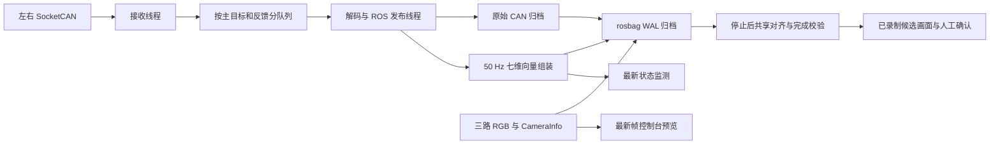

# 相机完成选帧与采集数据流优化（2026-11-12）

## 结论与范围

本次修改完成候选选择、真实数据启动门禁、实时监测回调调度和候选画面显示。保留现有 40 ms 同步门限、原始 Header 和完整原始归档，不推断或自动写入技能成功。原始 episode_000010 未修改。

当前数据流结构合理，没有发现重复来源发布者或 CAN 队列损失。它仍有 Python ROS 序列化和进程间传输的成本，不能称为 CPU 成本最低的实现。本次修复已确认的回调积压和完成帧重复计算，不扩大到重构已稳定的 CAN 驱动。

## 修改内容

### 完成候选从合格图像组选择

`completion_validation.validate_completion` 支持一次读取搜索顶部与执行侧腕部候选；单左臂不会将右腕当作必要动作观测，双臂同时检查双侧。所有自动候选必须满足：

- 位于结束边界之前 100 ms 内，stale 边界使用严格小于；
- 与结束边界位于同一连续来源域，不能跨中断借用早期成功；
- 精确选中的相机 Header 参与有效因果图像组，来源年龄、CAN/RGB/总体同步及 16 步条件继续成立；
- 从合格候选中选择实际时间最近的一张，不固定优先顶部相机。

校验复用 `to_lerobot.read_episode` 与 `select_sft_frames`。新增 `completion_header_range` 仅限制需要建立精确完成索引的时间范围；完整轨迹仍检查，没有缩减轨迹质量检查。普通导出默认仍建立全部完成索引。

候选记录实际话题、Header、选帧策略、图像组参考时刻、图像/状态/下一状态来源 Header、偏差、连续帧和窗口数量。单臂和双臂都遵守逻辑裁切终点。技术失败时仍可保留明确未合格的回放候选，不授予资格。

### 实际数据和落盘均就绪后开始任务

新增 `startup_readiness.py`：启动期间短暂订阅所需 RGB、CameraInfo 和执行臂反馈，至少观察到两次递增的新鲜 Header；反馈还必须完整、有限、无 stale 和缺失。检查 rosbag 订阅关系，并只读查询首批已提交消息，保证图像覆盖确实存在于本条 bag。

图像和 CameraInfo 仅检查序列化 CDR 的 12 字节前缀，不解码像素；小型反馈向量执行有效性检查。成功和失败都会销毁临时订阅，正常采集不保留额外图像订阅。证据写入 `startup_data_readiness`。主目标静止可能停发，故不要求它在启动前持续刷新；最终动作来源及质量仍由逐条审计检查。

该门禁解决“仅发现发布者就开始计时”，不替代整条 Episode 的同步验收。

### 存储采用 WAL，避免启动读写争锁

诊断首轮暴露了旧 SQLite 模式下的读写锁冲突，诊断 rosbag 因 `database is locked` 退出。该失败只发生在独立诊断录制，旧任务数据及原采集服务未受影响，证据保留。

新录制均写入独立 `recording_storage.yaml`：`busy_timeout=5000`、`journal_mode=WAL`、`synchronous=NORMAL`。启动查询通过 WAL 并行读取已提交记录，不与写入争用回滚日志锁。原有 256 MiB 缓存与原始归档 QoS 保留。正常停止后的独立数据库可回读，并继续执行完整性检查。WAL/NORMAL 不授予掉电时最后一批缓存数据的持久性保证。

### 实时监测与归档分工

原服务循环只处理一次 ROS 回调，再最多等待 50 ms；50 Hz 主目标监测可能积压。改为：

- 实时主目标监测使用 BEST_EFFORT、depth=1，只取最新状态；它不承担完整归档。
- 启动期间最多处理 32 个回调，受 5 ms 时间预算约束；录制期间每轮最多 8 个，空闲时 1 个。
- 复用执行器，避免反复加入/移除节点；空闲时不批量轮询空队列。
- rosbag 的原始 CAN 和向量完整录制及失效检查保留。

本轮实测曾发现空闲批量轮询使录制器 CPU 升至单核约 8.9%，已在最终版本消除；最终空闲约 2.0%。没有把这个中间版本当作优化成果。

### 控制台显示实际已录制完成画面

新增停止后按精确 Header 读取的 `completion_preview` 请求。图像只在候选或确认帧变化时传输一次，不放入每秒状态轮询。控制台将对应相机窗格显示为“已录制完成画面”，明确显示 Header 相对时刻；其他窗格仍为实时预览。回放内容按候选身份缓存，按窗口大小缓存缩放结果。

候选画面加载成功后才能点击“确认候选完成帧”。确认仍由操作者作出；松手是否完成必须按任务定义判断。确认、保存、源导出验收和训练资格保持各自原有职责。

## 数据流检查

原始 CAN 与七维向量同时保存有明确用途：前者用于逐帧来源审计，后者用于状态、动作与时间对齐，属于有意保留的两层数据。当前 RGB 录制配置不订阅或录制顶部用于帧时钟的深度图；控制台也没有配置深度预览，因此不做无用深度渲染。

当前各配置来源均有唯一发布者。左右 CAN 诊断的 `overflow`、`publish_errors`、`shutdown_discarded` 均为 0，队列瞬时深度为 0～1；不证明设备在接收前没有遗漏，也不把主目标静止 stale 解释为链路故障。

最终空闲 5 秒采样，CPU 百分比以一个逻辑核为 100%：

| 组件 | CPU |
| --- | ---: |
| 左/右 CAN 进程 | 43.95% / 42.96% |
| 左/右向量进程 | 65.92% / 66.32% |
| 左腕/右腕/顶部相机 | 7.92% / 7.92% / 5.15% |
| 控制台 | 38.40% |
| 空闲录制器 | 1.98% |

合计约 2.81 个逻辑核，本机 40 个逻辑核；这是这些采集进程的短时使用量，不是整机所有应用负载。向量节点每条 CAN 消息的反序列化和 Python 调度是后续仍可优化的成本点。若将来负载增大，可评估同进程组装以减少一次进程间传输，但需要重新验证线程安全和来源映射，本次未更改。

## 验证结果

- 主回归：111 项通过。末次调度改动后的启动/标注定向回归 35 项通过；末次候选边界定向回归 5 项通过，包括新增双臂裁切边界测试。
- 桌面 ROS 合成闭环通过：启动、实时预览、候选原图读取、人工确认、窗口关闭后继续录制、保存/丢弃及重启后跨磁盘目录发现；最终预览接收至显示 p95 为 27.2/27.8/27.6 ms。
- 现有相机与 CAN 全话题只读启动探测通过，约 1.567 s 同时确认 7 路所需实时来源与首批实际落盘；正常停止、完整性检查 `ok`，实际数据库模式为 WAL。
- episode_000010 只读复验：新策略自动选中左腕 Header `1794466257655192000`，图像组偏差 11.706160 ms，96 帧、81 窗口；校验约 0.604 s。前后来源摘要均为 `ffc3c31774ee07d0b282705ecab12cfb2fa996948d3e4619e7f5288118ba5ce2`。没有补写旧标注或更改原始 Episode。
- 最终版再次录制全话题并保持静止 5 秒：约 1.544 s 就绪，左右反馈各 251 帧，invalid/stale 均为 0；2008/2008 个去重原始 CAN 引用匹配；三路 RGB 无 Header 倒退或超过 100 ms 的缺口；双方 CAN 损失计数均为 0，WAL 数据库完整性 `ok`。
- `git diff --check` 通过。

这些结果验证软件行为、静止数据流和可复核候选，不代替下一条主动示教 Episode 的完整技能验收。

## 运行与证据

录制服务及控制台已在空闲且无暂存 Episode 时重启，CAN 与相机驱动未重启，也未向机械臂发送控制命令。最终录制器 PID `711151`，控制台 PID `710844`；最终状态空闲。

证据目录：`/home/mips/pi05_datas/validation/collection_pipeline_fix_20261112/`，包括复现脚本、主回归及定向回归日志、桌面闭环日志、首轮锁冲突日志、WAL 探测 bag、来源复验、实时发布者与诊断、CPU 采样及重启记录。诊断录制未写入任务 Episode 编号序列。

下一条采集时等待界面进入“录制中”后开始动作；停止后查看标为“已录制完成画面”的窗格，再确认完成候选。新数据仍须逐条审计。
