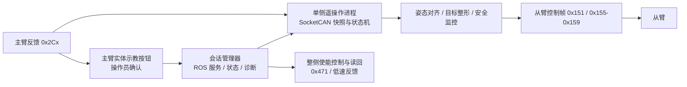

# 两 CAN 主从臂遥操作的技术实现

> **历史流程，已停用。** 当前操作见[官方固件直连说明](OFFICIAL_NATIVE_TELEOP.md)。

本文记录“手动进入主臂实体示教 → 主从姿态自动对齐 → 主从遥操作 → 停止遥操作 → 手动退出实体示教 → 从臂六关节和夹爪返回本轮起点 → 核对原位 → 主从臂失能”流程的实现架构、状态转换、数据通路和安全约束。它描述软件如何协作完成该流程，不是现场操作步骤。系统背景、CAN 协议依据、变更历史和详细测试记录见[两 CAN 上位机实现方案](TWO_CAN_HOST_TELEOP_IMPLEMENTATION.md)。

## 1. 系统边界与拓扑

每侧主臂与从臂接入同一条 SocketCAN 总线。主臂通过离线偏移配置使用 `0x2Cx` 反馈和 `0x15x` 控制地址；从臂使用默认地址。控制进程通过同一 CAN 接口直接接收和发送帧。ROS 2 用于会话管理、状态和诊断，不在逐周期运动数据路径中。



一个物理总线上的 `0x471` 使能/失能帧是广播语义；低速使能反馈也不能可靠区分同总线上主、从臂。因此软件把它作为“整侧”动作与读回处理，不假设可以仅使能或仅失能其中一台。`0x470` 会改写偏移配置，不属于运行期控制路径。

## 2. 模块职责

| 模块 | 职责与边界 |
| --- | --- |
| `piper_two_can_teleop.py` | 单侧会话状态机、SocketCAN 收发、主从快照、对齐后衔接、目标滤波/限速、停流、从臂自动回位与失能前核对。实时控制由该进程直接完成。 |
| `piper_two_can_align.py` | 独立单侧对齐器；支持主从姿态对齐以及以固定关节角为目标的从臂回位。执行前规划目标、限位和轨迹，执行期间监控反馈与安全条件。 |
| `piper_two_can_identity.py` | 只读验证总线身份、地址分离、反馈完整性和频率等前置条件。 |
| `piper_two_can_manager.py` | ROS 管理层，协调单侧/双侧启动、实体示教确认、停止、释放确认、状态与诊断；不承担每帧转发。 |
| `piper_arm_enable.py` | 整侧 `0x471` 使能/失能帧与低速反馈读回；逐关节检查整个采样窗口，避免同 ID 的主从臂反馈被末帧覆盖。 |
| `piper_master_state.py`、`piper_feedback.py` | 复用主臂偏移反馈解码、单位换算、限位及滤波等基础逻辑。 |

会话内的 `RETURNING` 状态复用对齐器的轨迹和监控逻辑，管理器继续提供实体示教释放确认与状态发布。独立对齐器仍可用于单独的固定目标回位，但正常摇操退出不再依赖额外启动独立进程。

## 3. 状态与转换

单侧遥操作会话的主要状态为：

```text
OFFLINE → IDLE_DISABLED → ARMING → WAIT_TEACH → ALIGNING → ACTIVE
                                                    ACTIVE → WAIT_TEACH_RELEASE
  RETURNING → WAIT_TEACH_RELEASE → STOPPING → IDLE_DISABLED
  故障或门禁失败 → FAULT_LATCHED
```

`ARMING` 表示发出整侧使能请求并等待读回；`WAIT_TEACH` 等待操作员通过主臂实体按钮进入示教并作软件确认；`ALIGNING` 完成新鲜状态采样、规划、自动对齐和末端验证；`ACTIVE` 才接受主臂增量并发送从臂目标。停止实时跟随流并让从臂待机后进入 `RETURNING`，完成固定目标回位与核对；成功后才进入 `WAIT_TEACH_RELEASE`，要求操作员关闭实体示教并提交新的释放确认；`STOPPING` 才发送整侧失能并验证 `IDLE_DISABLED`。

任何故障锁存均禁止自动回到 `ACTIVE`。故障会话完成停流后，操作员可显式调用
`stop`，使用同一会话冻结的起点执行恢复回位；回位成功后仍须新的实体示教释放确认、
原位核对和失能读回。恢复回位不能重新进入跟随。物理按钮的状态由操作员确认；总线
模式字节不能替代实体示教按钮状态的确认。

回位目标是在启动请求后、重新通过只读门禁且尚未使能时冻结的从臂六关节角与夹爪开口，不是机械零位或笛卡尔空间 Home。起点角若比指令边界超出不超过 `0.5°`，同时冻结原始六关节快照与投影到边界内的可指令目标；之后对齐重规划不改写这两个快照。回位完成后重新采样两次，两次间隔至少 `0.2 s`；六关节最大偏差须不超过对齐终点容差，夹爪开口偏差须不超过 `3 mm`，才允许发送失能帧。

## 4. 反馈快照与实时控制通路

主从臂六关节角度分别由三组高速反馈帧组装：主臂 `0x2C5`～`0x2C7`，从臂 `0x2A5`～`0x2A7`。每组帧的关节原始量以 `0.001°` 解码为角度。只有三帧均新鲜且满足最大时间偏差约束时才形成有效快照；默认过期阈值为 `30 ms`、组内最大时间偏差为 `10 ms`。新快照带有代次标识，控制循环对同一主臂代次最多生成一次新目标，避免高频循环重复消费旧样本。

低速帧 `0x261`～`0x266` 用于观察关节使能状态。它们用于判断整侧是否一致使能/失能，不作为逐周期位置反馈。使能请求后等待启动稳定时间，再在采样窗口核实六关节状态；“帧发送成功”不等于“动作已生效”。

主臂新快照经过身份/新鲜度校验、限位检查、滤波与速率限制后，编码成从臂控制帧：关节控制 `0x151`、`0x155`～`0x157`，夹爪控制可用 `0x159`。遥操作不向主臂发送运动控制帧，也不在运行时改变地址偏移。ROS 管理消息与状态发布不承载关节目标流。

## 5. 示教后的姿态对齐

实体示教确认后，软件重新采样主从姿态，而不是复用启动前的读数。对每关节以主臂当前角度为目标、从臂当前角度为起点，先验证目标关节范围、整侧使能、反馈新鲜度、主臂稳定性和总线健康，再构造平滑轨迹。摇操启动规划允许从臂反馈起点超出指令边界不超过 `0.5°`，并将起始指令投影到边界内；更大的起点越界仍拒绝。规划默认拒绝超过 `30°` 的初始差值；目标限位修正最多 `1°`。轨迹使用五次 minimum-jerk 曲线：

```text
s(u) = 10u³ - 15u⁴ + 6u⁵,  u ∈ [0, 1]
q(u) = q_start + (q_goal - q_start) · s(u)
```

时长由最短时长和峰值速度约束共同确定，默认最短 `2 s`、峰值速度 `5°/s`。曲线峰值速度系数为 `1.875`，因此规划时长至少为 `1.875 × 最大关节位移 / 峰值速度`。运动期间检查主臂漂移、从臂跟踪误差、反馈超时、使能变化、关节边界和总线错误；例如主臂漂移容差为 `0.5°`、对齐跟踪误差容差为 `3°`。完成后还需末端角度误差在容差内，并通过静止探测确认无持续变化，才允许转入 `ACTIVE`。

回位复用平滑固定目标轨迹，但目标来自本轮保存的从臂起始角和夹爪开口，而非实时主臂输入；回位期间关闭主臂跟随。回位仍需新鲜主从反馈作为运行安全监视输入，并遵守限位、使能、总线健康、终点误差和待机约束。

## 6. ACTIVE 跟随与退出

ACTIVE 阶段每个有效主臂快照生成对应关节目标。目标链包含死区、滤波（alpha-beta 与后续平滑链）和速率约束，随后以配置的控制频率发送。默认控制频率为 `200 Hz`；当前现场已验收的是 `50 Hz`。默认速度百分比为 `100%`，对齐使用单独的低速规划值。夹爪作为第七个目标量随动：从臂开口目标为主臂开口的 `1.5` 倍，并限制在 `0～80 mm`；超过从臂最大开口时钳制到 `80 mm`。可用 `--no-gripper` 关闭夹爪控制。双侧目标流已有真机运行记录；实际最大开口、零点精度和夹持力仍待测量。

会话持续监控主臂/从臂反馈、使能样本、CAN 错误状态和外部控制帧。ACTIVE 阶段的跟踪误差仍计算并显示，但不会因误差大小或持续时间停流；主臂快速运动和机械响应延迟可造成较大瞬时误差。主臂角度超出从臂可指令范围时，先钳制输入，再对其滤波并输出限位内目标，运行状态仍报告触限位关节。对齐与固定目标回位仍检查轨迹跟踪误差和终点误差。ACTIVE 期间，六关节反馈三帧若短暂超过 `10 ms` 同步门限，当周期不发送新目标；恢复同步后继续，连续不同步达到 `100 ms` 则停流。反馈过期仍立即停流。可恢复类 CAN 错误采用默认 `5 s` 滚动窗口和 `20 Hz` 频率阈值评估，bus-off、error-passive、总线错误以及检测到的外部控制流会直接进入故障处理。

结束请求或超时后停止生成新目标，并发送从臂标准待机控制。软件不借用主臂模式切换帧模拟实体退出。会话保留整侧使能，自动把从臂六关节和夹爪送回本轮起点；成功后要求新的实体示教退出确认，再重新取得新鲜反馈并核对原位，才发送整侧失能帧，并检查窗口内样本全部为 disabled。回位或核对失败时不发送失能帧，保留使能并报告故障；需要人工处理。故障导致反馈丢失、无法确认原位时也停流并保持使能。

## 7. 安全不变量与故障策略

- 只有身份、反馈完整性、整侧使能读回、实体示教确认、关节限位和总线健康都满足，才允许进入自动运动状态。
- 任何位置目标须落在关节指令限位内；ACTIVE 阶段对超限的主臂输入钳制后继续，自动对齐和回位仍拒绝异常起点或过大的姿态差。
- 运动期间失去新鲜反馈、使能异常、外部控制帧或严重 CAN 故障，均停止目标流并令从臂待机；对齐还检查主臂漂移；对齐和回位都检查轨迹跟踪误差和终点误差。故障后不能自动续跑。
- `0x470` 仅属离线配置用途。运行期不得发送；`0x170`/`0x171` 不替代实体按钮退出；`0x471` 是整侧广播，任何使能/失能都必须结合低速反馈读回判断结果。
- 失能可能使机械臂受重力影响。软件状态机只保证协议动作与读回次序，不能检测人员是否托稳、空间是否清空，相关物理条件需由现场流程建立。

## 8. 当前实现与验证边界

已有实现覆盖单侧身份检查、minimum-jerk 对齐、ACTIVE 关节跟随、停止待机、自动回位、实体示教释放确认和整侧使能状态读回。左右两侧已再次完成同时 `50 Hz`、`30 s` 的六关节加夹爪跟随。左侧在同一管理器会话内完成自动回位、原位核对和失能；右侧自动回位被管理器联锁误打断，随后独立固定目标回位并在核对六关节与夹爪后失能。联锁误打断已修复并通过离线测试，仍待双侧真机回归。双侧夹爪均观察到开合目标；左侧先前独立采样的主臂 `15.3 mm` 与从臂 `22.4 mm` 约为 `1.46` 倍，运行命令达到 `80 mm` 上限。现有证据不能证明默认 `200 Hz` 控制、端到端延迟、夹爪实际到达 `80 mm`、零点精度或夹持力。测试记录见[实现方案第 18 节](TWO_CAN_HOST_TELEOP_IMPLEMENTATION.md)。

回位过程曾遇到左侧 CAN 错误帧突发，完成后右侧只读窗口也报告 `CAN_ERROR`。下一轮真机运行前需排查总线并重新通过双侧只读身份检查。先前单侧右臂测试的周期日志最高跟踪误差为 `23.68°`；周期日志最高显示值并非全周期误差峰值。

现有记录还显示左侧从臂 J3 起点为 `2.216°`，略超当前指令上界 `2°`。本轮只在运行进程内给予微小检查容差以完成回位；仓库与控制器限位未改。后续应核对零点和指令边界，避免长期依赖该临时容差。测试数据、具体参数来源和软件修复记录保存在[实现方案第 15～18 节](TWO_CAN_HOST_TELEOP_IMPLEMENTATION.md)。

后续仍需在下一轮真机测试中验证双侧都能在同一管理器会话内完成自动回位、夹爪到位和失能前重新采样，并为回位故障后的人工恢复定义明确操作。管理器退出时会停流但不强制失能；若会话已经开始运动，应在关闭管理器前完成实体示教释放确认、回位和失能读回。

## 9. 可选的放宽门禁预设

单侧会话和双侧管理器支持 `--gate-profile relaxed`。该预设针对当前共享总线的
可恢复瞬态与受控对齐扩大下列阈值；没有显式指定时继续使用 `standard`。各个对应
命令行参数仍可覆盖预设值。

| 条件 | `standard` | `relaxed` |
| --- | ---: | ---: |
| 六关节反馈新鲜度 | `30 ms` | `50 ms` |
| 三帧快照最大跨度 | `10 ms` | `20 ms` |
| ACTIVE 连续快照不同步宽限 | `100 ms` | `250 ms` |
| 5 秒滚动 CAN 错误帧速率 | `20 Hz` | `50 Hz` |
| 自动对齐最大姿态差 | `30°` | `60°` |
| 目标允许钳制量 | `1°` | `2°` |
| 对齐与回位终点容差 | `0.5°` | `1°` |
| 对齐期间主臂漂移 | `0.5°` | `1°` |
| 对齐与回位跟踪误差 | `3°` | `5°` |

放宽预设仍要求身份确认、启动前整侧失能、使能/失能读回、实体示教进入与释放确认，
并继续执行关节指令范围、bus-off/error-passive/总线错误、外部控制帧、反馈完全丢失、
故障锁存和 CAN 接口写入互斥。它不会把 `recoverable` 改为忽略所有错误。

双侧 `50 Hz` 不限时运行示例：

```bash
python3 -u -m piper.piper_two_can_manager \
  --port-left can_left --port-right can_right --rate 50 \
  --gate-profile relaxed --send --workspace-clear
```

使用 launch 文件时写作：

```bash
ros2 launch piper start_two_can_teleop.launch.py \
  send:=true gate_profile:=relaxed
```


## RETURNING 的服务与失败约定（2026-10-07）

`stop` 和 `--duration` 到期都触发同会话回位，回位期间不读取主臂角度作为目标，但仍要求新鲜主从反馈与正常使能。操作员应保持回位空间清空，等到 `WAIT_TEACH_RELEASE` 再关闭实体示教并确认。`running` 仍只表示 `ACTIVE`，判断是否正在回位须读取 `state == RETURNING`。

| 请求或事件 | 行为 |
| --- | --- |
| 重复 `stop`（单侧或双侧） | 幂等；不重新规划、不重置时限、不取消已经开始的回位，也不代替释放确认 |
| `FAULT_LATCHED` 后调用 `stop` | 目标流已先停；故障线程退出后重新取得同一 CAN 写锁，以本轮冻结起点启动恢复回位。成功后进入新的 `WAIT_TEACH_RELEASE`，不能恢复 ACTIVE |
| `start` | 仅存活且为 `IDLE_DISABLED` 的会话接受；进行中或已结束的会话拒绝重新启动，不覆盖冻结起点 |
| 提前 `teach_released` | 拒绝，不缓存；回位及核对成功后新开确认窗口，旧确认不能跨窗口复用 |
| 窗口内重复 `teach_released` | 幂等地确认同一窗口；窗口关闭后拒绝，不重复失能流程 |
| `/teleop/{left,right}/cancel_return` | 仅 `RETURNING` 接受；取消回位，尽力发送待机并锁存故障，不自动失能或重试；已锁存时返回幂等成功 |
| 回位总时限 | `--return-timeout`，默认 `120 s`，覆盖采样、探针、轨迹、夹爪等待与到位核对；不因重复请求延长 |
| 释放确认时限 | `--teach-release-timeout`，默认 `300 s`，从回位成功后的新确认窗口起算；拒绝或超时锁存故障，退出码 `4`，不发送失能帧 |
| 回位超时、取消、反馈/总线/跟踪故障、程序异常 | 停流待机并进入 `FAULT_LATCHED`，退出码 `3`；不自动回位重试、不发送常规失能帧。故障条件处理后可重新显式调用 `stop` 发起一次恢复回位 |
| 失能读回失败 | 有限次重试后锁存故障，不能报告 `IDLE_DISABLED`；此时实际使能状态需人工核对 |
| 双侧联锁 | 一侧正常结束不打断另一侧回位；联锁会话一侧故障时取消仍存活的另一侧，故障不触发自动恢复 |
| 管理器退出 | 取消未完成的回位/确认流程、尽力停流，不把进程退出当作实体释放确认 |
| 单侧终端 Ctrl-C | 跟随/对齐中第一次表示正常停止并回位；回位或退出阶段再次收到则取消并锁存故障 |

正常结束后会话为单次使用；同一 `TeleopSession.run()` 再调用只返回原退出码，不重新发帧。重新启动前须处理故障并重新通过门禁。单侧终端释放确认要求交互式 TTY，并丢弃回位完成前输入的字符；服务方式仅接受当前窗口的新调用。所有软件确认都只是操作员声明，不能证明实体按钮状态。

管理器、单侧会话和独立 `piper_two_can_align` 按 SocketCAN 接口名共享本机文件锁。发送会话从只读门禁开始到最终关闭持续持锁，等待实体确认以及更换接收 socket 时也不释放。独立回位进程在获取不到锁时拒绝发送；左右不同接口互不阻塞。锁文件不删除，进程退出后内核释放锁；不要通过删除锁文件绕过占用。该锁只协调采用此约定的本机工具，不能阻止其他 CAN 程序或其他主机，运行时外部控制帧检测仍保留。正常退出不启动独立回位进程。

此顺序与取消服务已做离线模拟验证，尚未进行真机回归；第 18 节旧试验记录中的“释放后回位”保留为历史证据，不代表当前操作顺序。
